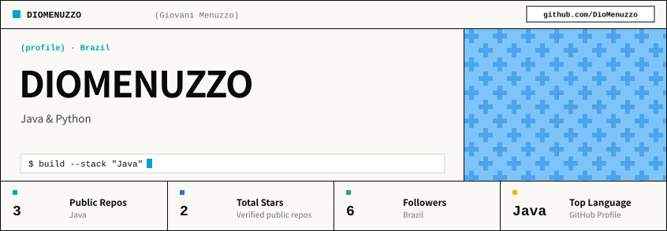
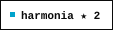
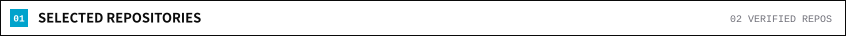
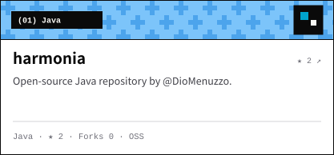
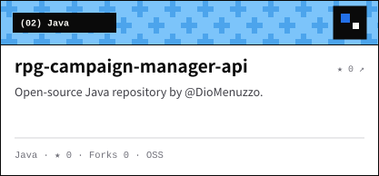

<!-- Generated with GitSkins (https://gitskins.blessc.com) · Theme: swiss-bauhaus-pixel -->

  <a href="https://github.com/DioMenuzzo">
    <picture>
      <source media="(prefers-color-scheme: dark)" srcset="./assets/hero-dark.svg">
      
    </picture>
  </a>

  <a href="https://github.com/DioMenuzzo"><picture><source media="(prefers-color-scheme: dark)" srcset="./assets/btn-github-dark.svg"></picture></a>
  <a href="https://github.com/DioMenuzzo/harmonia"><picture><source media="(prefers-color-scheme: dark)" srcset="./assets/btn-flagship-dark.svg"></picture></a>
  <a href="https://github.com/DioMenuzzo?tab=repositories"><picture><source media="(prefers-color-scheme: dark)" srcset="./assets/btn-repos-dark.svg"></picture></a>

  <picture>
    <source media="(prefers-color-scheme: dark)" srcset="./assets/sec-work-dark.svg">
    
  </picture>

  <a href="https://github.com/DioMenuzzo/harmonia"><picture><source media="(prefers-color-scheme: dark)" srcset="./assets/card-harmonia-dark.svg"></picture></a>&nbsp;<a href="https://github.com/DioMenuzzo/rpg-campaign-manager-api"><picture><source media="(prefers-color-scheme: dark)" srcset="./assets/card-rpg-campaign-manager-api-dark.svg"></picture></a>

  <picture>
    <source media="(prefers-color-scheme: dark)" srcset="./assets/sec-activity-dark.svg">
    
  </picture>

